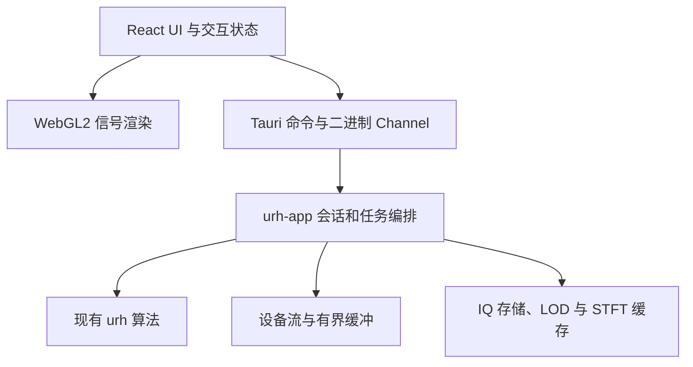
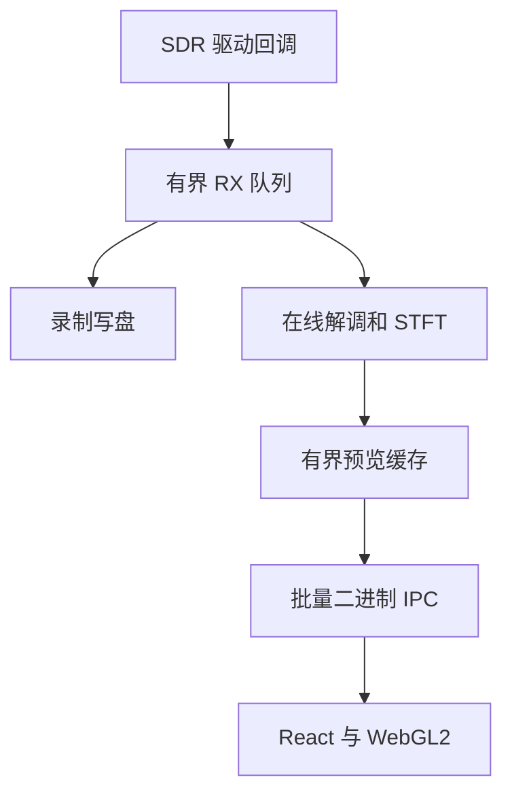

# urh GUI 架构方案

**决策**:采用 Tauri 2 作为桌面应用容器、React + TypeScript 作为 UI 层、WebGL2 负责高密度信号绘制,保留现有 Rust `urh` 核心作为信号处理与设备后端。新增独立的 Rust 应用服务层,不让前端直接处理原始大规模 IQ 数据。

**目标读者**:项目维护者和参与 GUI、DSP、设备适配、发布测试的开发者。

**实施基线**:2026-10-29,基于 [stevenjoezhang/urh-rs](https://github.com/stevenjoezhang/urh-rs) 当前 `master` 的公开代码;优先保障 macOS,架构从第一天兼容 Windows/Linux。功能采用分期实现,不要求第一版一次性复刻原版 URH。性能数字均为待测试的工程目标,而非已实现指标。

> 注:方案原文以根 package 名 `urh-core` 撰写;该 crate 现已定名 `urh`(见 ADR-001),文中 `urh-core` 一律读作 `urh`。

# 项目目标与非目标

## 目标

1. 将现有离线 IQ 分析、解调、协议解析、设备控制和协议生成能力组合为可交互的桌面应用。
2. 面向大型文件和实时 SDR:滚轮缩放、拖拽平移、选区、时间轴对齐、频谱/瀑布图与协议字段联动时保持流畅。
3. 在 Rust 层维持已有算法的样本级/比特级一致性测试;GUI 不得重新实现会导致结果分叉的 DSP 算法。
4. 支持跨平台安装包、设备不可用时的优雅降级、项目文件保存与恢复。
5. 以离线信号分析为 MVP,随后接入实时采集、发送、AWRE 与 Simulator。

## 第一阶段不做

- 不在浏览器中运行完整 DSP;JavaScript 仅做交互、坐标变换和图形渲染。
- 不把原始全速 IQ 流逐样本发送到 React,也不为每个采样点创建 DOM/SVG 节点。
- 不默认引入本地 HTTP/WebSocket 服务或公网连接;Tauri IPC 足以覆盖初期控制与预览。
- 不在初期搬迁/重写已通过一致性测试的 Rust 核心;保留 CLI 与已有测试。

# 现有代码基线与缺口

| 现有部分 | 代码位置 | GUI 需要补足的能力 |
| - | - | - |
| IQ 格式与文件读取 | `src/iq.rs` | 文件元数据、按视窗读、分层抽样缓存、超大文件加载 |
| 解调及协议解析 | `src/modulation.rs`、`src/protocol.rs` | 可取消分析任务、跨视图选区定位、结构化编辑结果 |
| 频谱 | `src/spectrogram.rs` | 增量 STFT、频谱 tile 缓存、实时纹理更新 |
| SDR 设备 | `src/devices/mod.rs` | 设备生命周期、能力枚举、背压与独立录制 |
| AWRE、Simulator | `src/awre/`、`src/simulator/` | 结构化模型、规则编辑、状态可视化 |
| CLI 与测试 | `src/bin/urh-cli.rs`、`tests/` | 继续作为回归基准,不与 GUI 强耦合 |

**两个必须提前处理的技术点:**

- `Device::start_rx` 当前接收 `std::sync::mpsc::Sender<IqChunk>`。这是无界发送通道,实时采集速率超过消费速率时可能持续积压。应用层必须提供有界缓冲、溢出策略和明确的丢包指标;如果要修改公共 trait,应兼顾原有测试与设备实现。(见 ADR-003)

- 现有 `Spectrogram::new` 复制输入样本,`stft()` 再复制并为每帧分配数据,`data()` 重新完成整段 STFT。这适合离线一致性验证,但不应在每次实时 GUI 刷新时调用。另需校验 `overlap_factor = 1.0` 时 `hop_size() = 0` 的边界情况。

原版 URH 的 Qt GUI 包含波形选择、协议表格、仿真编辑等大量自定义视图;迁移 GUI 时应复刻用户任务和交互语义,而不必逐像素仿照原布局。

# 总体架构与仓库组织



首次迭代**保留仓库根目录原有 `urh` package**,通过 Cargo workspace 加入新 crate,减少移动源码给历史测试和 CI 带来的风险(ADR-001,已按此实施)。

```text
urh-rs/
  Cargo.toml                  # 原有 urh;增加 [workspace](default-members = ["."])
  src/                        # 保持现有纯 Rust core
  tests/                      # 原有 golden / integration tests
  crates/urh-app/             # 新增 Rust 应用服务层
    src/{session,signal,analysis,capture,project,transport}.rs
  apps/desktop/
    package.json              # React + TypeScript + Vite
    src/
      app/                    # app shell、路由、布局和状态
      features/               # interpretation / protocol / spectrum / generator
      components/             # controls / virtual tables
      render/                 # WaveformRenderer、WaterfallRenderer
      bridge/                 # typed Tauri API、二进制协议
    src-tauri/                # Tauri Rust entry、commands、capabilities
  docs/                       # 本方案、ADR、IPC 契约、性能基线
```

责任边界:

- **urh**:算法、文件格式、设备驱动和稳定的领域结构;不依赖 React/Tauri。
- **urh-app**:SignalRepository、SessionManager、AnalysisJobManager、CaptureManager、ProjectService;提供可取消任务和状态快照,控制内存及线程。
- **src-tauri**:调用适配、序列化、权限检查、窗口与系统对话框;尽量薄。
- **React**:窗口停靠、表单、协议编辑、键盘快捷键、选择状态及跨视图联动。
- **WebGL2**:绘制波形、选区和瀑布图;计算结果由 Rust 提供。

每个任务使用稳定 `session_id`、`signal_id` 和单调递增 `generation`,在切换文件、调整参数或连续缩放时丢弃过时响应。

# 应用模型与 Tauri IPC

## 核心模型

- `SignalMeta`:ID、文件路径显示名、样本格式、采样率、样本数、频率、时间原点、读写状态。
- `ViewRange`:半开区间 `[start_sample, end_sample)`;内部始终采用整数样本索引,坐标轴才换算成时间。
- `AnalysisConfig`:调制方式、symbol length、center/noise、滤波与编码链参数。
- `ProtocolDocument`:message、bit range、label、participant、CRC、人工编辑与自动推断元数据。
- `DeviceSession`:设备 ID、能力集、连接/采集/发送状态、流统计和最近错误。
- `UiProject`:打开的信号引用、分析参数、注释、停靠布局及 UI 偏好。

Rust `u64` 的 ID、绝对样本索引若可能越过 JS 安全整数范围,应通过十进制字符串或明确的 BigInt 适配传输;不要让 `number` 静默损失精度。采样率单位统一为 Hz,时间统一由样本索引和采样率推导。(P0 判定:v1 样本数远小于 2^53,JSON number 即精确,见 ADR-004。)

## IPC 分类

| 类型 | 例子 | 推荐通道 |
| - | - | - |
| 低频命令 | `open_signal`、`set_analysis_config`、`list_devices` | Tauri `invoke` + JSON DTO |
| 按视窗查询 | `get_waveform_envelope`、`get_spectrogram_tile` | `invoke` 返回原始二进制响应 |
| 状态与进度 | `capture_status`、`analysis_progress`、`device_error` | Tauri Channel,结构化消息 |
| 连续预览 | 新波形概要、FFT 行、状态计数 | 有界合批 + 二进制 Channel,UI 端限频 |
| 完整 IQ | 大型原始文件、全速采集 | 留在 Rust 文件/缓冲/录制管线,不走 UI IPC |

Tauri 2 支持 `tauri::ipc::Response::new(Vec<u8>)` 和 `InvokeResponseBody::Raw`,前端接收 `ArrayBuffer`。**不要使用 `Channel<Vec<u8>>` 期待零 JSON 开销**:它会被序列化为数字数组。流式二进制可用 `Channel<InvokeResponseBody>`(或相应 `Response` 通道)。详见 [Tauri Raw IPC](https://docs.rs/tauri/latest/tauri/ipc/struct.Channel.html)。

## API 草案

```text
open_signal(path) -> SignalMeta
close_signal(signal_id) -> Result
get_waveform_envelope(signal_id, start, end, width_px, mode, generation) -> ArrayBuffer
get_spectrogram_tile(signal_id, tile_x, tile_y, lod, config_hash) -> ArrayBuffer
analyze_signal(signal_id, AnalysisConfig) -> JobId
cancel_job(job_id) -> Result
get_protocol_page(job_id, offset, limit) -> ProtocolPage
list_devices() -> DeviceInfo[]
start_capture(DeviceConfig, record_path?) -> DeviceSessionId
stop_capture(session_id) -> CaptureSummary
send_signal(session_id, signal_id, tx_config) -> JobId
save_project(path, project_id) -> Result
```

- IPC 二进制数据建议统一:`magic + version + dtype + request_id + shape + payload`,固定小端字节序、长度校验与最大帧大小。避免将数组直接 base64/JSON 化。(v1 已按此实施,帧格式见 [ipc-contract.md](ipc-contract.md)。)
- 对同一视图的快速缩放,只保留最新请求;旧工作尽早取消,无法取消的结果以 generation 判定丢弃。
- 错误使用稳定 `code`、`message`、`details`,设备异常不可只弹通用报错。
- Rust 重任务在后台线程池执行;Tauri 主线程仅处理短命令和窗口生命周期,禁止同步读取大文件或执行 STFT。

# 波形、频谱与协议的可视化设计

## 波形渲染

**目标**:打开千万级乃至亿级采样文件时,平移、缩放与选区操作的计算量主要由屏幕宽度而非文件总样本数决定。

1. 为信号构建多级 min/max envelope(金字塔或按块聚合)。视口宽 `W` 像素时请求约 `O(W)` 个包络数据,保留尖峰;绝不能只每隔 N 点取 1 点。
2. 放大到每像素少于数个原始采样点时,按需读取并绘制真实波形;远距离缩小时使用 min/max 垂直线段。
3. GPU 缓存顶点 buffer;`Float32Array`/typed arrays 承载 payload。平移优先复用可见 tile,缩放时分级重采样。
4. I/Q、幅度、相位、频率分别有独立绘制模式,共享统一的 X 轴 sample coordinate 与选择模型。
5. 选区、bit 边界、消息区间、拖拽 handles、marker 用独立 overlay pass 绘制,避免修改底层采样 buffer。
6. 统一 `screen ↔ sample` 坐标变换,避免整数索引在多次浮点换算后产生 off-by-one,特别是消息边界。

## STFT 与瀑布图

- 在 Rust 层增加独立增量 `StreamingStft` / tile service;保留已有 `Spectrogram` 作为参考实现和回归 oracle。
- 输入按采样窗口和 hop 增量计算,保留跨 chunk 的重叠样本,不在每帧重算完整历史。
- 频谱块支持 `fft_size`、hop、窗函数、dB 范围、频轴方向与缓存键。与现有 URH 基准保持一致,明确画面使用 FFT shift/镜像的语义。
- WebGL2 使用 2D 纹理;新增行通过 `texSubImage2D` 更新,颜色映射放在 fragment shader,调节色表和 dB 范围时不重算 FFT。
- 大型离线频谱使用多级 tile(类似地图切片)与 LRU 缓存;实时瀑布图用固定高度环形纹理/滑动窗口。
- WebGL context lost、GPU 不可用或驱动禁用时显示可理解的错误,必要时提供低帧率 Canvas2D 降级。

## 协议视图与跨视图联动

协议分析采用虚拟化网格,而非为全部 bit 建 DOM 节点。展示 Bit/Hex/ASCII、消息分组、参与者、字段颜色、CRC 结果及编辑状态;为长消息提供按需分段。

单一全局选择模型保存 `signal_id + [sample_start,sample_end)`,并以明确的映射表维护 `message_id + [bit_start,bit_end)`。波形选择、协议高亮和 Generator 片段引用共享同一领域选择,不以屏幕像素作为持久化坐标。

前端技术建议:FlexLayout(停靠面板)、TanStack Virtual(长列表/表格)、React 状态库(会话及 UI 状态)、WebGL2 自定义 shader(信号图);常规曲线可以用 uPlot 辅助,但核心波形选区与频谱最好维护自有渲染器。

# SDR 实时采集与发送

## 流水线



- 驱动回调线程只负责快速复制或移交 chunk,不执行耗时 GUI/DSP,也不因 UI 锁长期阻塞。
- 采集/录制与预览采用分离消费者,并规定优先级。**预览帧可丢,真实录制样本是否丢失必须单独计数、报告并处理**,不能把预览丢帧策略施加在录制上。
- 预览队列必须有界;优先丢弃旧预览帧,确保操作者看到最新频谱。后台任务要有取消和停止超时。
- 发送(TX)和接收(RX)明确状态机:`Idle → Opening → Receiving / Transmitting → Stopping → Idle`;失败时进入可恢复 Error 状态,确保驱动资源释放。
- 设备设置按 capability 显示。频率、采样率、带宽、增益、天线、bias tee 的可用性与值域应来自设备能力而非 UI 硬编码。
- 当设备 SDK 缺失、设备拔出、参数不支持、磁盘写满或文件权限失败时,GUI 显示具体恢复操作。

## 数据量量级

复数采样以 `Complex32` 表示,每个 IQ pair 为 8 字节。10 MS/s 约 80 MB/s、4.8 GB/min(不计文件系统开销)。若将其原样交给 WebView,则 IPC、GC 和 GPU 上传都会成为额外瓶颈。

预览限制为可见窗口所需的 envelope、FFT 行或降采样数据;连续 30 Hz 的 UI 更新是初始目标,可按设备与窗口可见性调整。完整录制路径必须独立于这个刷新率。

# UI 信息架构与交互规范

采用桌面工作台布局:左侧信号/项目树,中间可停靠工作区,右侧上下文参数与标注面板,底部日志、任务、设备状态。默认深色主题;支持多显示器、高 DPI、布局重置和快捷键。

| 工作区 | 第一批能力 | 后续能力 |
| - | - | - |
| Interpretation | IQ 打开、波形/频谱切换、选区、分析参数 | 自动参数估计、滤波链、多信号对齐 |
| Protocol Analysis | 消息表、Bit/Hex/ASCII、字段标注、CRC | AWRE、参与者推断、差异比较 |
| Spectrum | 设备枚举、中心频率/增益、实时频谱 | 瀑布、测量 marker、录制 |
| Generator | 生成信号、参数面板、发送预览 | 序列编辑、循环发送、Fuzzing |
| Simulator | 暂保留入口/占位 | 图形化规则/动作编辑、实时状态与 transcript |

交互与可用性要求:

- 快捷键和右键菜单要可发现;`Cmd/Ctrl+O` 打开信号、`Cmd/Ctrl+S` 保存项目、空格暂停/继续预览可作为默认规范。
- 用户修改解调参数时采用防抖与任务取消;结果更新不应清除仍可映射的选区、缩放位置和手工标签。
- 处理错误时区分:不可用设备、暂时失败、数据格式错误、资源不足和算法失败。非致命错误放入状态栏/任务面板,不反复弹模态框。
- 项目保存应保留原始文件路径引用或相对路径,并校验外部 IQ 文件是否变化;默认不把巨大 IQ 数据重复嵌入项目。
- 重要的标签、协议修改、设备发射操作应配备撤销/确认策略,避免误发射。

# 安全、权限和跨平台兼容

## Tauri 安全边界

1. 使用 Tauri 2 capabilities 为窗口与插件配置最小权限;优先通过 Rust 命令完成文件访问,不把广泛的文件系统读写权限赋予全部前端组件。
2. 生产包仅加载打包的本地前端资源;配置严格 CSP,避免任意远程脚本、动态代码和未经验证的外部 URL。(P0 切片暂为 null,见 ADR-004 与 P0 完成清单。)
3. 所有 IPC 参数由 Rust 验证:路径、`signal_id`、区间顺序、长度上限、数值边界、设备控制值。不要认为前端参数可信。
4. 外部数据包括 IQ、PCAP/PCAPNG、XML、项目文件、设备元数据均视为不可信输入;限定解析时间/内存、数组乘积溢出和嵌套深度。
5. TX/高功率相关功能设置明确的用户操作与状态提示,不在恢复历史项目时自动开始发射。
6. 初期禁用不必要的远程能力、任意 shell 命令和自动更新;未来若加入更新,使用签名验证并独立设计发布权限。

参考 [Tauri Security](https://v2.tauri.app/security/)、[Capabilities](https://v2.tauri.app/security/capabilities/)。

## 平台适配

| 平台 | 关键事项 |
| - | - |
| macOS | WKWebView 的 WebGL2/纹理行为、CoreAudio、动态 SDR `.dylib`、签名/公证、不同芯片架构;对音频输入申请正确权限 |
| Windows | WebView2 runtime、WASAPI、厂商 DLL 的装载路径、USB 驱动安装说明、x64 安装包与代码签名 |
| Linux | WebKitGTK 与 GPU 驱动差异、ALSA、`.so` 搜索路径、udev 规则和分发包依赖 |

Tauri 2 在三大桌面平台依赖不同的系统 WebView,不能仅用 Chrome 开发环境代表最终性能;WebGL2 特性、GPU 纹理格式、DPI、键盘快捷键都需要实机测试。[Tauri WebView Versions](https://v2.tauri.app/reference/webview-versions/)。

设备后端当前采用运行时 `libloading` 查找厂商库;发布策略需区分应用自身授权代码、第三方驱动与厂商 SDK 的分发许可。没有驱动的机器仍应能打开离线文件。

# 性能目标、测试与 CI

## 建议的可测目标

以下是 **MVP 验收目标,必须在约定基准机上测量**,不能作为现有性能声明。

| 场景 | 初始验收目标 |
| - | - |
| 1000 万复数样本的离线视图 | 交互仅请求视口所需数据,不在 UI 端常驻完整样本数组 |
| 平移/缩放 | 通常达到 60 FPS;在基准机上采集 p50/p95 frame time,而非只看平均值 |
| 实时频谱预览 | 初期目标 20–30 FPS;UI 渲染落后时不拖慢采集/录制 |
| 长时间录制 | 测量完整写盘速率、缓冲峰值、丢样本计数和磁盘写满行为 |
| 连续缩放/频繁改参数 | 不出现无限待处理任务;过时结果不会覆盖最新视图 |
| 大型协议消息表 | 使用虚拟化,滚动内存和 DOM 数量不随消息总数线性膨胀 |

至少建立 3 组固定测试数据:短小 golden IQ、千万级随机/脉冲 IQ、真实采集且带已知协议标签的 IQ。每一组覆盖不同采样格式、采样率和长度,包含坏文件/截断数据。

## 测试层次

- **Rust 核心**:保留 `cargo test`、原版 URH 真值比较及 AWRE/Simulator 回归;GUI 改造不应更改输出语义。
- **Rust 应用层**:文件分页、LOD min/max、增量 STFT、缓存淘汰、任务取消、队列满、掉设备、磁盘写满的单元/集成测试。
- **IPC 契约**:二进制 header/version、大小端、恶意长度、超界 sample range、取消/乱序与前端 typed array 解码的一致性。
- **React**:组件、焦点、快捷键、选择联动、撤销、虚拟化表格测试。
- **WebGL2**:Shader/tile 拼接的图像基线、坐标映射、选区边界、纹理更新、context lost 恢复。
- **系统 E2E**:macOS/Windows/Linux 每平台测试打开信号、分析、保存项目、设备不可用降级;有实际 SDR 的硬件冒烟测试单列,避免让普通 CI 必须接硬件。

记录指标:打开耗时、平均/p95 帧时间、峰值 RSS、CPU、GPU、IPC 吞吐、录制丢样本数及恢复次数。每次性能优化附上输入规模、机器规格和可复现基准,避免无条件声称"高性能"。

# 分阶段实施与完成标准

| 阶段 | 开发交付 | 验收标准 |
| - | - | - |
| P0 架构验证 | Cargo workspace、Tauri+React shell、typed IPC、FlexLayout、一个 WebGL2 canvas | 三平台能启动;离线 IQ 可选文件并显示元数据;无 SDK 时不崩溃 |
| P1 离线波形 | SignalRepository、LOD min/max、区域缩放与选区、基本频谱 tile | 千万采样文件平滑操作;峰值不被抽样丢失;GPU/IPC 内存有界 |
| P2 协议分析 | AnalysisJob、参数编辑、虚拟化协议表、波形/协议双向选区 | 与已有 golden 数据的 bit/message 输出一致;取消/乱序正确 |
| P3 实时设备 | DeviceManager、录制与预览独立队列、FFT 实时瀑布 | 有界队列、预览可丢帧而录制丢样本可检测;拔设备可恢复 |
| P4 生成与高级分析 | Modulation/Generator、AWRE 标注、Project 保存 | 项目重开结果稳定;发送必须显式启动;完整操作可回放 |
| P5 Simulator/发布 | Simulator 场景编辑、打包、签名、跨平台回归 | 关键流程文档齐全;CI 与人工设备验收通过 |

**推荐首个 PR 的边界**:只做 P0 + P1 中的一条垂直切片——打开 `.complex` → Rust 按视口生成 envelope → Tauri 原始二进制响应 → WebGL2 显示 → 鼠标缩放/拖动 → 与屏幕宽度同步重新请求。暂不改动原版设备驱动 API。该切片验证了项目最关键的技术路径,也能作为之后所有图形界面的性能基准。

每一阶段结束时保留一个可运行、可测试的应用;不要先大规模搭界面再补数据链路。

# 风险、决策与待确认事项

| 风险 | 影响 | 缓解措施 |
| - | - | - |
| JS/Rust 间大数据传输 | 复制、GC、延迟抖动 | Rust 端 LOD 和 tile;原始二进制 IPC;benchmark 决定单帧大小 |
| STFT 全量重算 | 高频 CPU、内存抖动 | 增量处理与独立缓存;保留旧实现验收一致性 |
| 无界队列 | 长时间采集导致内存耗尽 | 录制/预览分流、有界队列、背压/丢包观测 |
| WebView 平台差异 | Shader/纹理兼容性和打包问题 | Chrome 外的真实 WKWebView、WebView2、WebKitGTK 回归 |
| 信号坐标精度 | 波形与 bit 选区错位 | 整数样本索引和半开范围;统一坐标映射与边界测试 |
| SDR 厂商库 | 动态链接失败或许可问题 | 设备能力枚举、可解释错误、分平台打包审计 |
| UI 状态分叉 | 过时结果覆盖新参数 | request generation、任务取消、不可变分析快照 |
| 大文件/不可信输入 | 内存过载和潜在崩溃 | 文件长度、tile 大小、解析复杂度与整数溢出校验 |

## 开工前确定的 5 个 ADR

1. **ADR-001**:保留根 package `urh`、以 workspace 添加 UI 与应用层,还是整体迁移 crate?默认保留。(已决策:保留,见 docs/adr/)
2. **ADR-002**:初期数据读取按需分块还是 mmap?默认分块读 + LRU,性能数据不足前不强制 mmap。(已决策:MVP 整文件内存 + 块 LOD,分页后置)
3. **ADR-003**:预览和录制的队列溢出策略、可接受录制丢样本行为及磁盘写满恢复流程。必须写入设计。(P3 前定)
4. **ADR-004**:统一 sample index、bit range 与屏幕坐标的数据契约,以及二进制 IPC 版本规范。(已决策,见 ipc-contract.md)
5. **ADR-005**:先支持哪些 SDR 做真实硬件验收?建议至少一个 RTL-SDR 接收路径与一个可收发设备路径;其余后续扩展。(P3 前定)

# 主要参考

- [urh-rs README](../README.md)、[Cargo.toml](../Cargo.toml)、[devices](../src/devices/mod.rs)、[spectrogram](../src/spectrogram.rs)
- [原版 URH](https://github.com/jopohl/urh)(PyQt6 交互与算法参照)
- [Tauri 2 前端调用 Rust](https://v2.tauri.app/develop/calling-rust/)、[调用前端与 Channel](https://v2.tauri.app/develop/calling-frontend/)、[Raw IPC](https://docs.rs/tauri/latest/tauri/ipc/struct.Channel.html)
- [Tauri capabilities](https://v2.tauri.app/security/capabilities/)、[WebView 版本](https://v2.tauri.app/reference/webview-versions/)
- [FlexLayout](https://github.com/caplin/FlexLayout)、[uPlot](https://github.com/leeoniya/uPlot)、[WebGL2 API](https://developer.mozilla.org/en-US/docs/Web/API/WebGL2RenderingContext)

**实施原则总结**:Rust 保持 DSP 与设备的唯一真相;React 管理复杂交互;WebGL2 负责按视窗高效显示;每一种高吞吐或长时间任务都必须有界、可取消、可观测,并在三平台上验证。
